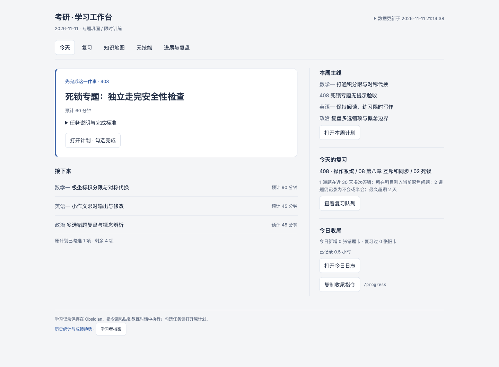
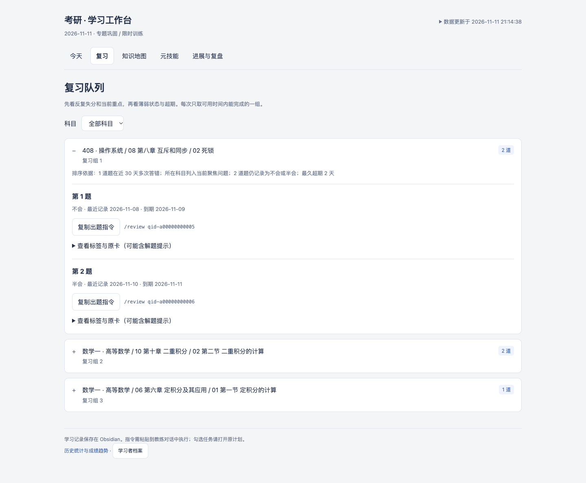
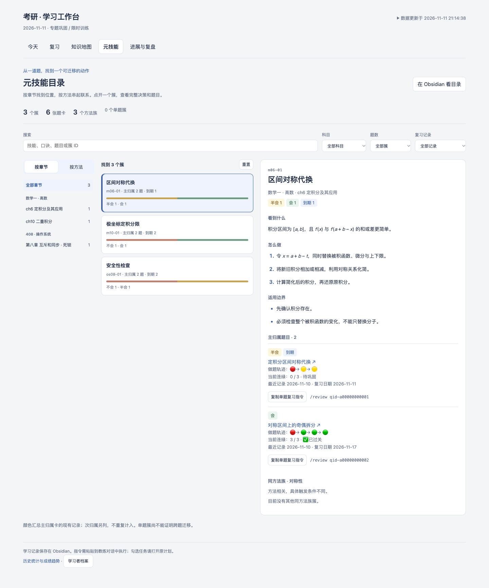
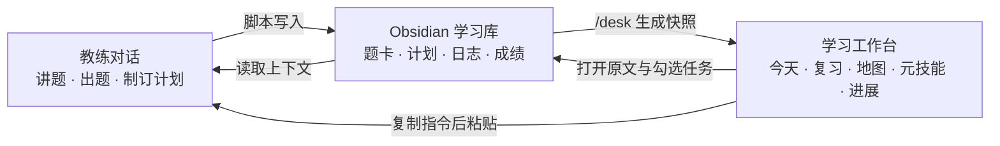

# Kaoyan 2027 Coach

**把题讲明白，把短板记清楚，把每天要做的事排出来。**

一个围绕 Obsidian 学习库工作的考研 AI skill：对话负责讲解与判断，Python 脚本负责记录与统计，工作台负责把下一步摆在眼前。面向数学一、408、英语一和政治；其中数学一与 408 的专项答疑、错题结构和配图支持更完整。

[快速开始](#快速开始) · [使用手册](docs/USAGE.md) · [开发维护](docs/MAINTAINING.md) · [演示图复现](docs/demo/README.md)

## 先看实际效果

下图均由仓库现有代码生成，使用**虚构演示数据**，不包含个人学习记录。它们展示的是当前界面。

### 今天：打开就知道先做哪件事



左侧突出首个未完成任务与后续安排，右侧集中本周主线、到期复习和收尾入口。完成状态来自 Obsidian 原计划中的勾选。

### 复习：先处理反复失分，再看超期



按科目筛选到期题，展开后查看推荐依据并复制指定题卡的复习指令。标签与原卡入口默认折叠，避免提前看到解题提示。

### 元技能：把多道错题串成一个可复用的方法



用“看到什么 → 怎么做 → 适用边界”组织解题方法，关联同类错题。🔴 不会、🟡 半会、🟢 会；历史末尾连续三次绿灯表示**这道题**过关，知识点掌握仍需独立验收。

## 它能帮你做什么

| 你的需求 | 入口 | 结果 |
| --- | --- | --- |
| 恢复进度，安排今天 | `/load`、`/plan_today 6h`、`/desk` | 档案摘要、今日任务与本地工作台 |
| 听懂一道题并留下可复习的记录 | 直接发题；需要归档时用 `/wrong` | 完整题面、错因、解法、按需配图和关联题卡 |
| 检查是否真的掌握 | `/review`、`/test` | 复习排期、考点复验、带作答条件的测试证据与知识地图更新 |
| 把旧题迁移到同类问题 | 工作台“元技能” | 方法簇、适用边界、主次归属和历史轨迹 |
| 收尾、记录成绩和调整计划 | `/progress`、`/score`、`/recap week` | 学习日志、卷子成绩、复盘与下一步建议 |
| 导入 Gemini 的 408 章节拷打 | `/grill latest` | 章节掌握报告、可映射考点与学习日志 |

数学一按李林讲义组织知识地图；408 按《老汤讲408》一轮大纲组织，包含 4 模块、32 章、147 节。数学与 408 的过程图可通过 Python 生成 SVG 并保留源码，简单关系可用 Mermaid。

## 三个入口如何配合



**工作台是本地 HTML 快照。** “复制指令”后需要粘贴到教练对话执行；任务在 Obsidian 原计划中勾选。教练写完学习记录后会刷新已有工作台，手动修改笔记后可再发 `/desk`。浏览器刷新本身不会重新扫描学习库。

学习记录保存在本地 Markdown / JSON 中，换对话后可通过 `/load` 恢复；对话内容仍由你选择的 AI 工具处理。

## 快速开始

### 1. 获取并安装

准备 Python 3.9+、Obsidian，以及支持加载 `SKILL.md` 的 AI 工具。下面的安装命令适用于带 Bash 的 macOS / Linux 环境。

```bash
git clone https://github.com/storm-crypto/kaoyan-2027-coach.git
cd kaoyan-2027-coach
python3 --version
bash setup.sh
```

安装脚本为 `~/.claude/skills/` 和 `~/.codex/skills/` 创建软链接；其他工具按各自的 skill 发现机制配置。安装前会检查 Python 3.9+；失效或指向旧目录的链接会明确报错。安装后可运行 `bash setup.sh --check` 做只读自检。

需要 Python 配图时，在仓库根目录安装可选依赖：

```bash
python3 -m venv .venv
.venv/bin/python -m pip install matplotlib numpy
```

核心记录与工作台生成使用 Python 标准库；绘图脚本可以自动使用仓库 `.venv` 中的依赖。

### 2. 指向你的 Obsidian 学习库

把下面一行加入 `~/.zshrc` 或 `~/.bashrc`，将路径替换为自己的学习目录：

```bash
export KAOYAN_OBSIDIAN_ROOT="/path/to/your/obsidian/vault/Kaoyan_2027_Prep"
```

重新加载对应 shell 配置，并确保运行教练的进程能读取这个变量。也可以在对话中明确提供学习库绝对路径，由脚本参数覆盖。

### 3. 从一次真实学习开始

在已加载此 skill 的对话中发送：

```text
/load 我准备考计算机，目标总分 360，每天可投入 6 小时，目前在 408 一轮复习。
/plan_today 6h
/desk
```

首次 `/load` 会创建缺失的档案和四科知识地图；院校、考试日期等信息按你的实际情况填写。普通使用者通过对话调用即可，无需手动拼 Python 参数。

之后用到哪个动作，再发对应指令：

```text
/review
/progress 时长 6h，李林高数推进到 p58，课后题 22/28，明天继续复习积分。
/score 数学一 卷型=模拟 卷子=模拟卷第1套 总分=118 选填=64 大题=54 主要问题=级数、积分不等式
/recap week
```

归档错题时，附上**来源、题目（含选项或截图）、自己的作答或错误思路**。忘记怎么填，发送 `/help wrong`、`/help progress` 或 `/help score`。

## 使用范围与当前边界

- **数学一 / 408**：有专门的答疑参考、章节映射、结构化题卡和配图流程。
- **英语一 / 政治**：已有基础答疑、知识地图、日志和成绩记录；专项教学流程的细化程度低于数学与 408。
- **限时训练 `/mock`**：目前由对话组织，尚无独立的计时与可回放批改脚本。
- **Gemini 导入**：目前仅支持 408 的 Voyager `gemini-voyager.chat.v1` JSON；默认收件箱为 `资料库/408/gemini_kaoda/`。
- **计划与复盘提醒**：skill 描述工作流程，不会仅靠安装自动建立定时任务。

## 文档与维护

| 文档 | 用途 |
| --- | --- |
| [完整使用手册](docs/USAGE.md) | 指令、文件落点与常见问题 |
| [开发维护说明](docs/MAINTAINING.md) | 数据真源、变更契约与回归重点 |
| [工作台规则](references/workbench.md) | 快照、复习入口与掌握证据的边界 |
| [演示图复现](docs/demo/README.md) | 用虚构数据重建截图中的工作台 |
| [评审与修复进展](docs/REVIEW-2026-11-11.md) | 已修复的问题、验证结果及尚待实施的优化建议 |

仓库中的 `SKILL.md` 是教练入口；`scripts/` 负责确定性读写，`references/` 放专项指导，`templates/` 放笔记模板，`tests/` 放回归测试。个人学习库不属于本仓库。

维护者运行测试：

```bash
python3 -m venv .venv
.venv/bin/python -m pip install pytest matplotlib numpy
.venv/bin/python -m pytest tests/ -q
```
