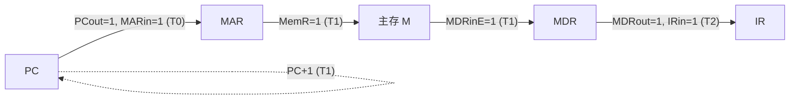
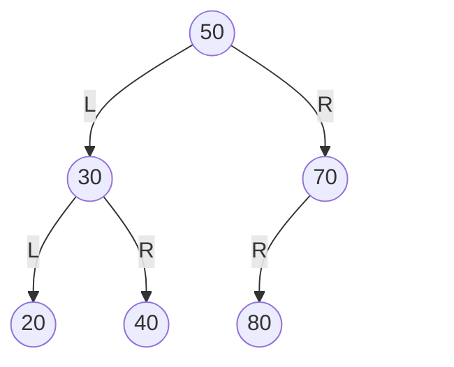
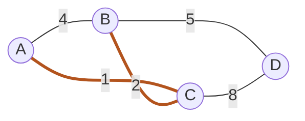
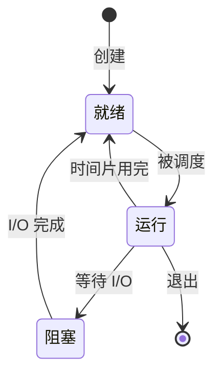
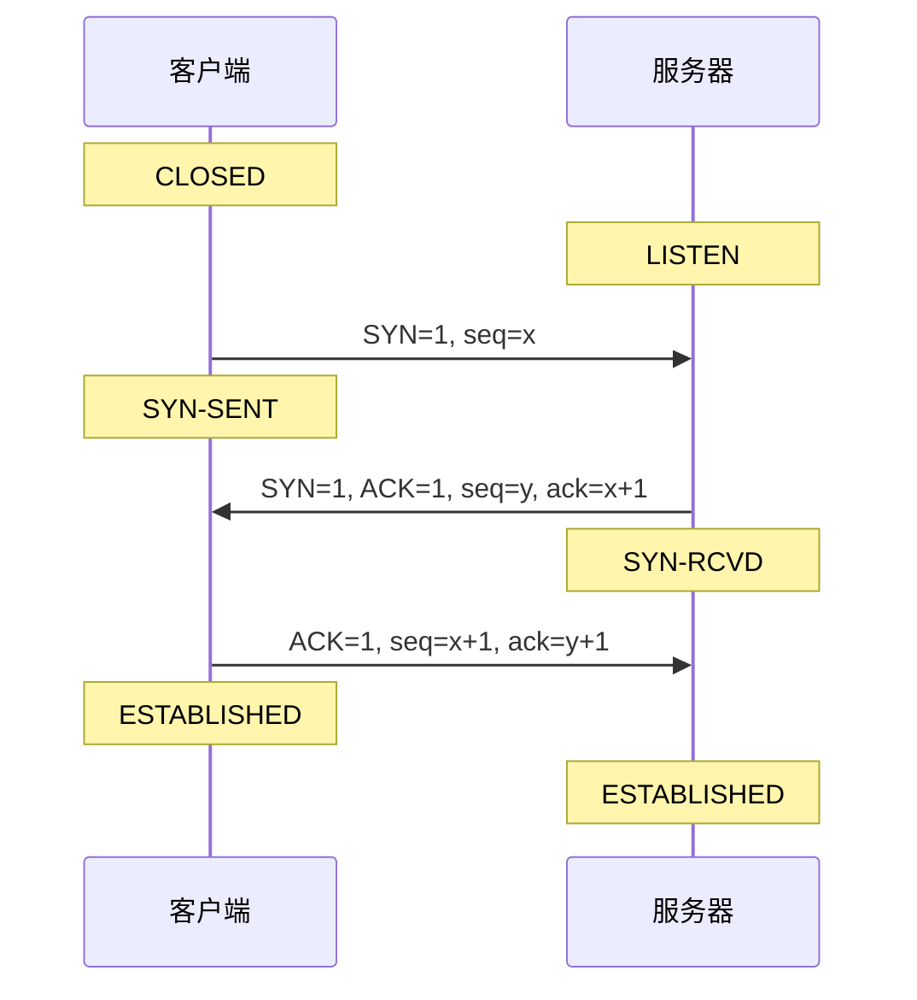
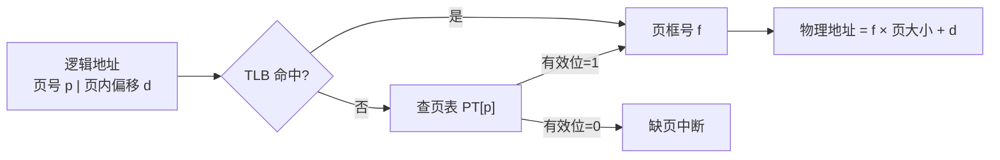

# Mermaid 与表格配图参考（408 结构与时序）

本文件用于**简单关系、状态转移、普通协议报文先后**以及精确数据表。需要控制位置、比例、格子对齐或分步高亮时，读 [408 Python 配图参考](408-python-figure-guide.md)。Mermaid 自动布局不表示真实时间、物理位置或位宽。

| 用 Mermaid | 用 Python | 保留 Markdown 表格 |
|---|---|---|
| 简单静态树/图、状态转移 | 树旋转、链表操作、图算法分步、数组对齐 | 状态数组、排序结果、资源矩阵 |
| 普通握手/挥手的报文先后 | 窗口变化、传播与超时的定量时间轴 | 字段值、报文头、子网范围 |
| 局部数据流向、地址查询路径 | Cache 比例字段条与映射、流水线、调度 | 位宽/周期核对、节拍、周转时间 |

按本题的理解难点选择，图和数据表可以配合；不因出现节点和箭头就一律选 Mermaid。

---

## 1. 硬性约束（`create_figure.py --kind mermaid` 会校验）

| 约束 | 原因 |
|------|------|
| 第一行必须是图类型（`flowchart LR` / `graph TD` / `sequenceDiagram` / `stateDiagram-v2`） | 没有声明整块不渲染 |
| 节点标签里有 `|` `(` `)` 时必须加引号：`A["PC (out)"]` | 未加引号会被当成语法，整图解析失败 |
| 禁止 `click`、`%%{init}%%`、外链、`<script>` | 静态阅读材料，且 Obsidian 已按主题配色 |
| 括号必须配平 | 最常见的解析失败原因 |
| 源码不带 ```` ``` ```` 围栏 | 围栏由建卡脚本自动加 |
| ≤ 8KB，节点 ≤ 15 个，行数 ≤ 40（超出告警） | 超了说明在画全景，该拆 |

不硬拦但必须遵守：

- **标签里不能写 LaTeX**。`$T_0$` 写成 `T0`，`PC_{out}` 写成 `PCout`。控制信号统一 `PCout=1` 这种纯文本。
- 中文标签可以用，但节点 ID 用英文（`MAR["主存地址寄存器 MAR"]`）。
- 一张图只承载一个认知动作。旋转前后、分裂前后各出一张。

---

## 2. Mermaid 骨架

### 2.1 数据通路的局部流向链（计组最高频）

保留本指令所需局部结构，控制信号标在箭头上。需要准确表达总线/复用器位置时改用 Python，不凭空新增硬件通路。



- 箭头标数据流向与发生节拍，和节拍表中的相应微操作对应；一项传送可以经过多段连线。
- 走总线的传送可经过 `BUS["内部总线"]` 节点；按题给硬件检查驱动源冲突、接收限制和并发微操作，不能将箭头数当作节拍数。
- 执行周期与取指周期分两张图，别叠在一张里。

### 2.2 简单静态二叉树（操作分步优先 Python）

Mermaid 布局器**不保证子节点左右顺序**，而 BST 和 AVL 旋转的采分点就是左右孩子。必须在边上标 L / R；缺一侧孩子时用不可见占位节点撑位置。



- 旋转、插入、删除这类过程题：画「操作前」「操作后」两张图，caption 写清是哪一步。
- 平衡因子直接写进节点：`A((50 / bf=+2))`。
- 堆用同样的骨架，并在 caption 里补一句数组下标对应关系。

### 2.3 图结构（邻接、遍历、最小生成树）



- 有向图用 `-->`，无向图用 `---`，权值写在边上。
- 遍历题在节点里写访问序号 `A((A ①))`；MST 题用 `linkStyle` 加粗选中的边，`linkStyle` 的编号按边出现顺序从 0 数。

### 2.4 进程状态、TCP 状态（每条边必须有触发事件）



没有触发事件的箭头等于没画。挂起态题再加 `就绪挂起` `阻塞挂起` 两个状态，并把「挂起」「激活」写在边上。

### 2.5 协议事件先后（定量时间与窗口分步用 Python）



- 报文关键字段写在箭头标签里，两端状态变迁用 `Note over`，别塞进箭头。
- 超时重传用 `C--xS: 丢失` 表示丢包，再画一次重传。
- 少量窗口状态可在 Note 中说明；需要看清窗口移动时用 Python 对齐序号格，涉及数值时延时用统一时间轴，不把 Mermaid 的箭头间距当时间比例。

### 2.6 地址翻译路径（页表、段页式、TLB + Cache）



多级页表按层级串成链：`一级页号 → 一级页表 → 二级页号 → 二级页表 → 页框`。每一步旁边写当前用到的位段。

### 2.7 网络拓扑 + 逐跳转发


拓扑图只放接口地址，转发过程用 3.4 的逐跳封装表。

---

## 3. 表格骨架

表格负责精确记录与核对，图负责空间、时间或操作关系。含位宽、周期、距离、概率等数值的表给出对应校验或合计；概念对照不凑合计行。

### 3.1 位段核对表（与 Python 按比例字段条配合）

| 位序 | 31 … 12 | 11 … 5 | 4 … 0 |
|:---:|:---:|:---:|:---:|
| 字段 | 标记 Tag | 组号 Index | 块内偏移 Offset |
| 位宽 | 20 | 7 | 5 |

位宽校验：`20 + 7 + 5 = 32 ✓`

遇到具体地址必须再补一行二进制切分：

`0x1234ABCD = 0001 0010 0011 0100 1010 1011 1100 1101` → Tag = `0x1234A`，Index = `0b1011110` = 94，Offset = `0b01101` = 13

### 3.2 流水线时空核对表

需要看重叠、停顿和依赖时用 Python 时空网格；表格保留精确状态。以下只示范五段、每段一周期、独立指令、无停顿，冒险题必须换成本题硬件假设与调度结果。

| 指令 | 1 | 2 | 3 | 4 | 5 | 6 | 7 |
|:---:|:---:|:---:|:---:|:---:|:---:|:---:|:---:|
| I1 | IF | ID | EX | MEM | WB | | |
| I2 | | IF | ID | EX | MEM | WB | |
| I3 | | | IF | ID | EX | MEM | WB |

合计：3 条独立指令、五段无停顿，共 7 周期；包含末条 WB。实际停顿格标出原因，总周期由实际完成时刻计算，不能照抄示例。

### 3.3 节拍与微操作对照表（计组数据通路大题采分标准）

| 时钟节拍 | 微操作（数据流向） | 有效控制信号（=1） | 通俗解释 |
|:---:|:---|:---|:---|
| T0 | (PC) → MAR | PCout, MARin | 把指令地址送到地址寄存器 |
| T1 | M(MAR) → MDR；(PC)+1 → PC | MemR, MDRinE；PC+1 | 发主存读；计数器自增 |
| T2 | (MDR) → IR | MDRout, IRin | 指令送到指令寄存器 |

校验：按题给硬件检查总线驱动冲突、接收限制与数据依赖；图中的路径、节拍与表对应，不按连线数量计节拍。

### 3.4 逐跳封装表（跨网段通信）

| 跳步 | 当前设备 | 报文 | 源 IP → 目的 IP | 源 MAC → 目的 MAC | 机制 |
|:---:|:---|:---|:---|:---|:---|
| 1 | 主机 A | IP 分组 | IP1 → IP6 | MAC1 → MAC2 | 目的不在本网段，ARP 查默认网关 |
| 2 | R1 | 同上 | IP1 → IP6 | MAC3 → MAC4 | 查路由表，下一跳 R2 |
| 3 | R2 | 同上 | IP1 → IP6 | MAC5 → MAC6 | 直连网段，ARP 查主机 B |

结论行：IP 端到端不变，MAC 逐跳更换。

### 3.5 拥塞控制 RTT 演进表

| RTT 轮次 | cwnd | ssthresh | 阶段 | 触发事件 |
|:---:|:---:|:---:|:---|:---|
| 1 | 1 | 16 | 慢开始 | |
| 4 | 8 | 16 | 慢开始 | |
| 5 | 16 | 16 | **进入拥塞避免** | cwnd 达到 ssthresh |
| 9 | 20 | 16 | 拥塞避免 | |
| 10 | 1 | **10** | **慢开始** | 超时，ssthresh = 20/2 |

转折点加粗；快重传与超时的处理不同，要在触发事件里写明是哪个。

### 3.6 排序快照表 / KMP next 表

| 趟数 | 数组快照 | 本趟动作 |
|:---:|:---|:---|
| 初始 | 49 38 65 97 76 13 27 | |
| 1 | **38** **49** 65 97 76 13 27 | 38 插入 49 前 |
| 2 | 38 49 **65** 97 76 13 27 | 65 不动 |

| j | 1 | 2 | 3 | 4 | 5 | 6 |
|:---:|:---:|:---:|:---:|:---:|:---:|:---:|
| 模式串 | a | b | a | a | b | c |
| next | 0 | 1 | 1 | 2 | 2 | 3 |

用 1 起始还是 0 起始要和教材一致，并在表上方注明。

### 3.7 调度时间核对表 + 周转时间表

运行过程优先画 Python 比例甘特图；以下表格保留可核对数值。

| 时间 | 0-3 | 3-5 | 5-9 | 9-11 |
|:---:|:---:|:---:|:---:|:---:|
| 运行 | P1 | P3 | P2 | P4 |

| 进程 | 到达 | 服务 | 完成 | 周转 | 带权周转 |
|:---:|:---:|:---:|:---:|:---:|:---:|
| P1 | 0 | 3 | 3 | 3 | 1.00 |

合计行给平均周转时间与平均带权周转时间。

### 3.8 页面置换逐次表

| 访问序列 | 7 | 0 | 1 | 2 | 0 | 3 |
|:---:|:---:|:---:|:---:|:---:|:---:|:---:|
| 帧 1 | 7 | 7 | 7 | 2 | 2 | 2 |
| 帧 2 | | 0 | 0 | 0 | 0 | 0 |
| 帧 3 | | | 1 | 1 | 1 | 3 |
| 缺页 | ✓ | ✓ | ✓ | ✓ | | ✓ |

合计：缺页 5 次，缺页率 5/6。

### 3.9 磁盘调度轨迹表

移动方向或端点/回卷是理解难点时配 Python 轨迹图，表格核对距离。访问序号不等于真实时间。

| 序号 | 磁道 | 移动距离 |
|:---:|:---:|:---:|
| 起点 | 100 | |
| 1 | 98 | 2 |
| 2 | 183 | 85 |

合计：总寻道 N 道，平均寻道长度 N / 请求数。不用 ASCII 折线，AI 画不齐。

---

## 4. 反例清单

- 无依据地新增 ALU/总线/寄存器连线，或画与本题无关的全景 → 只保留必要结构并高亮本步路径
- 二叉树不标 L/R → 布局器随手排，BST 的图会说谎
- 标签里写 `$T_0$` → 原样显示美元符号
- 节点标签 `A[PC(out)]` 不加引号 → 整图解析失败（脚本直接拒）
- 一张 sequenceDiagram 画完握手 + 数据传输 + 挥手 → 拆三张
- 位段表不写求和校验 → 少一位没人发现
- 表格里把最终答案（如「答案选 C」）写进去 → `/review` 一打开就泄底。**综合题例外**：节拍表、封装表这类本身就是解题过程的表，允许放在图示区，因为大题复习就是重做过程
- 用 ASCII 画磁头折线、流水线 → 对不齐，改用 Python，并保留计算核对表

---

## 5. 落盘流程

Mermaid 与 Python 都走 `create_figure.py`（Python 先看 PNG 预览），表格**直接写进解析文本**（`--formal-solution` 或 `--option-analysis`），不走图示区。

```bash
python3 scripts/create_figure.py \
  --question-id qid-xxxxxxxxxxxx \
  --kind mermaid \
  --slug 取指通路 \
  --caption "图1：取指周期 T0 至 T2 的局部数据流向链" <<'MMD'
flowchart LR
  PC["PC"] -->|"PCout=1, MARin=1  (T0)"| MAR["MAR"]
  ...
MMD
```

- 返回的 `figure_arg` 原样传 `--figure`，和 SVG 一样。
- 源码存成 `错题本/_附图/[qid]/[qid]-NN-[slug].mmd`，卡片里内联为 ```` ```mermaid ```` 代码块，前面一行 `%%图源：路径%%` 用来追溯。
- 建卡后在 Obsidian 里确认：图渲染出来了、树的左右和你的解析一致、深色模式下标签可读。
